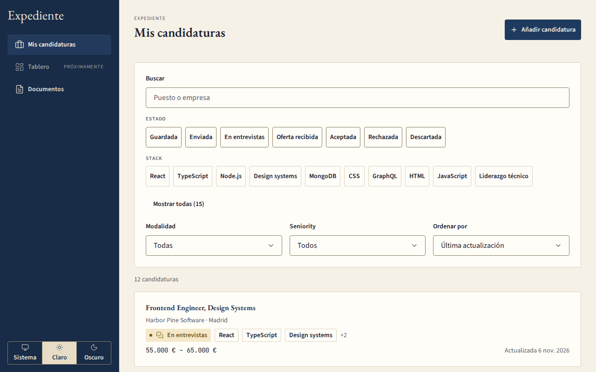

# Expediente

Expediente es un tracker de candidaturas de empleo, monousuario y local. Cada candidatura es un expediente con los datos de la oferta, el estado con su historial, las rondas de entrevista, las etiquetas y el CV vinculado. Pegas la descripción de una oferta y un modelo de lenguaje rellena el formulario para que lo revises.

Es el trabajo fin de curso de «Front End moderno + IA» de Lemoncode.



## Requisitos

- Docker con Compose v2.24 o posterior.
- Unos 10 GB libres en disco para las imágenes y el modelo local.
- Node 22 y npm 10, solo para desarrollar. El devcontainer ya los incluye.

## Arrancar en 3 comandos

```bash
git clone https://github.com/adetorresrivera/lemoncode-tfm-expediente.git && cd lemoncode-tfm-expediente
docker compose up --build -d
docker compose exec app npm run seed
```

Cuando termine, abre <http://localhost:8080>. La aplicación te lleva a `/applications` con la lista ya sembrada.

La primera vez, el servicio `ollama-init` descarga el modelo `gemma4:e2b` (unos 4,6 GB) en segundo plano. La aplicación funciona mientras tanto: solo la extracción con IA espera a que termine la descarga.

Solo se publican dos puertos, y ambos en la interfaz local:

- `127.0.0.1:8080`: la aplicación.
- `127.0.0.1:9001`: la consola de Silo (almacenamiento compatible con S3).

Las credenciales `minioadmin` / `minioadmin` son solo para desarrollo local. No las uses fuera de tu máquina.

## Datos de demo

`docker compose exec app npm run seed` carga 12 candidaturas y 3 documentos. Puedes repetirlo: reemplaza solo los datos de demo y conserva los tuyos.

Para ensayar desde cero, usa `--reset`. Borra todo antes de sembrar: todas las candidaturas, todos los documentos y sus archivos en Silo. Antes de borrar, el comando dice cuánto va a eliminar.

```bash
docker compose exec app npm run seed -- --reset
```

En el devcontainer, compila primero y luego siembra: `npm run build && npm run seed`.

## Ofertas para la demo

Tres ofertas de ejemplo, anonimizadas, para pegar en «Pegar oferta» al crear una candidatura:

- [`remote-senior.txt`](docs/demo/ofertas/remote-senior.txt): remota, senior, con rango salarial.
- [`onsite-junior.txt`](docs/demo/ofertas/onsite-junior.txt): presencial, junior, sin salario.
- [`english-nice-to-have.txt`](docs/demo/ofertas/english-nice-to-have.txt): en inglés, con «nice to have».

No están en la lista sembrada: se pegan en vivo para ver la extracción.

## Cambiar de modelo

Por defecto la extracción usa Ollama con `gemma4:e2b`. Para usar otro modelo, escribe `LLM_MODEL` en tu `.env` (mira «Variables de entorno») y ejecuta `docker compose up -d` otra vez. El servicio `ollama-init` lo descarga.

```bash
echo "LLM_MODEL=nombre-del-modelo" >> .env
docker compose up -d
```

También funciona un endpoint compatible con OpenAI: pon `LLM_PROVIDER=openai`, `LLM_BASE_URL` y `LLM_API_KEY` en tu `.env`.

### Calentar el modelo antes de la demo

La primera respuesta tras cargar el modelo es la más lenta. Unos minutos antes de presentar, lánzale una pregunta corta:

```bash
docker compose exec ollama ollama run gemma4:e2b "hola"
```

Compose mantiene el modelo cargado durante 30 minutos tras cada uso (`OLLAMA_KEEP_ALIVE`), así que un solo calentamiento cubre la charla.

## Si Ollama falla

Arranca con el proveedor simulado, que no necesita modelo ni conexión:

```bash
LLM_PROVIDER=mock docker compose up --build -d
```

El proveedor `mock` devuelve siempre el mismo borrador de ejemplo, sea cual sea el texto que pegues. Sirve para enseñar el flujo, no para probar el modelo.

Para volver a Ollama, ejecuta `docker compose up -d` sin la variable. Si dejaste `LLM_PROVIDER=mock` en tu `.env`, quítala antes.

## Comprobar que todo está sano

El script de humo levanta el stack, comprueba `/api/health`, simula la caída de Mongo y de Silo y verifica que la aplicación se recupera:

```bash
bash scripts/compose-smoke.sh
```

Opciones:

- `--down`: para los contenedores al terminar. Nunca borra los volúmenes.
- `--with-model`: espera además a que `ollama-init` termine de descargar el modelo y comprueba que `gemma4:e2b` está disponible.
- `--cold`: reconstruye la imagen en un proyecto aparte (`expediente-cold`), con volúmenes nuevos y sin puertos publicados, y comprueba el seed, la descarga de un PDF y la extracción simulada. Al terminar borra ese proyecto. No toca tus datos ni el modelo descargado. Necesita Compose v2.24 o posterior.

El script termina con `SMOKE OK` si todo va bien. Para la prueba en frío:

```bash
bash scripts/compose-smoke.sh --cold
```

Desde tu máquina (fuera del devcontainer) también puedes comprobarlo a mano:

```bash
curl http://localhost:8080/api/health
```

La respuesta esperada es:

```json
{ "status": "ok", "mongo": "ok", "s3": "ok", "llm": "ok" }
```

## Desarrollo en el devcontainer

1. Abre el repositorio en el devcontainer. Levanta Mongo, Silo y Ollama y define las variables de `.env.example`.
2. Instala las dependencias con `npm install`.
3. Arranca con `npm run dev`.

La web queda en <http://localhost:5173> y proxifica `/api` hacia la API, que escucha en el puerto 3000. El servidor de desarrollo de Vite escucha en todas las interfaces, así que la demo se hace con el stack de Compose, que publica solo en `127.0.0.1`.

## Estructura del repositorio

```text
apps/web            React 19 + Vite + TanStack Router
apps/api            Hono + MongoDB + Silo (S3)
packages/contracts  esquemas Zod y tipos compartidos
docs/               documentación del producto
docs/demo/ofertas/  ofertas de ejemplo para pegar en la demo
scripts/            humo de Compose y su override en frío
```

## Scripts

```bash
npm install                 # dependencias, desde la raíz
npm run dev                 # web (5173) + api (3000) en paralelo
npm run build               # contracts → api → web
npm run test                # vitest en todos los workspaces
npm run lint                # eslint
npm run typecheck           # tsc --noEmit en todos los workspaces
npm run format              # prettier --write
npm run format:check        # prettier --check
npm run seed                # datos de demo en Mongo y Silo
npm run seed -- --reset     # borra todo antes de sembrar
docker compose up --build   # entregable completo en http://localhost:8080
```

## Variables de entorno

`.env.example` lista todas las variables que lee la API. Cópialo a `.env` para cambiar valores; Compose lo lee solo.

```bash
cp .env.example .env
```

No subas nunca `.env` al repositorio: está en `.gitignore`. Cualquier clave real, como `LLM_API_KEY` para un endpoint compatible con OpenAI, va únicamente ahí.

## Calidad

- El pre-commit ejecuta ESLint y Prettier sobre los archivos en staging y después el typecheck de todos los workspaces. Un commit con un error de lint o de tipos se rechaza.
- El pre-push ejecuta la suite de tests completa.

## Documentación

- [`docs/PRODUCT.md`](docs/PRODUCT.md): qué es y qué alcance tiene.
- [`docs/DOMAIN.md`](docs/DOMAIN.md): modelo de datos y reglas.
- [`docs/ARCHITECTURE.md`](docs/ARCHITECTURE.md): estructura, API y despliegue.
- [`docs/DESIGN.md`](docs/DESIGN.md): sistema de diseño y UI.
- [`docs/AI-EXTRACTION.md`](docs/AI-EXTRACTION.md): la extracción con IA.
