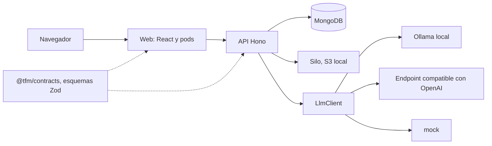
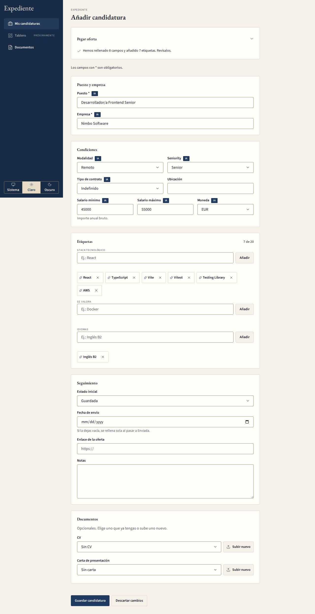
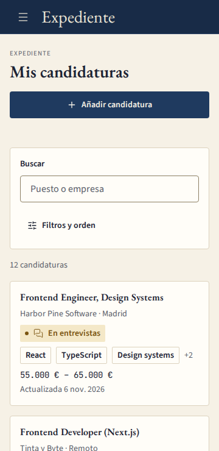
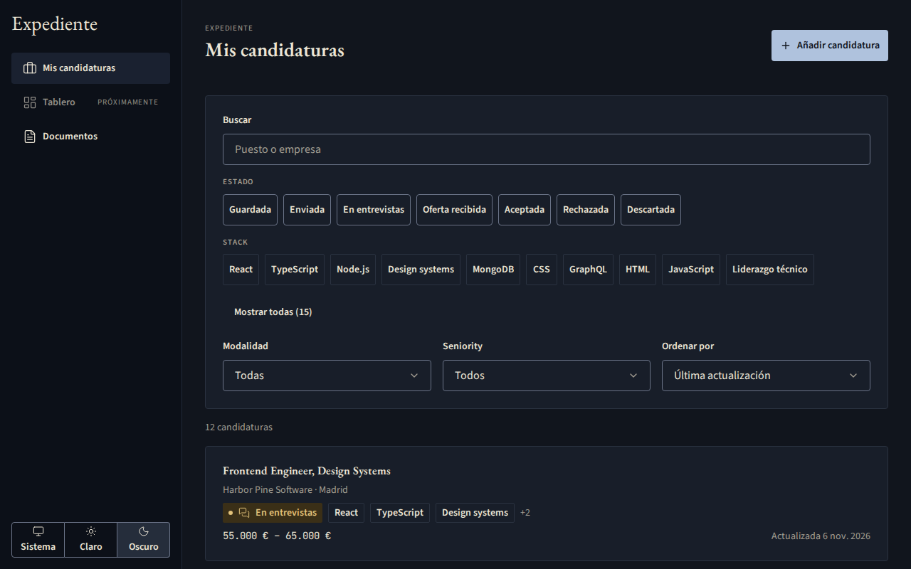
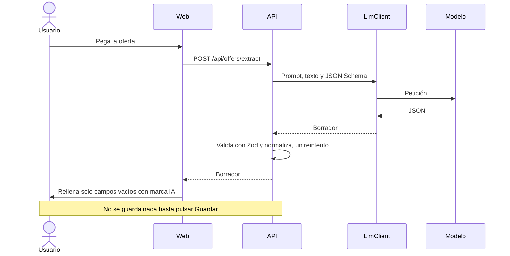
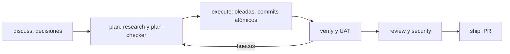

# Defensa — Expediente

## Cómo usar este guion

Este documento es la fuente de las diapositivas de la defensa del 9 de noviembre de 2026. Tú las dibujas en tu herramienta de presentaciones; aquí está lo que va en cada una.

- Son 11 diapositivas y suman 15:00, con la demo de 5:00 incluida. Las preguntas del tribunal van después y no cuentan en esos 15:00.
- Cada diapositiva tiene los puntos que se ven en pantalla, una nota del orador con lo que dices y su tiempo.
- El orden sigue las bases: idea y problema, MVP e iteraciones, demo, tecnologías y uso de IA, retos y aprendizajes, y próximos pasos.
- Los bloques Mermaid se ven como diagramas en GitHub y son lo bastante pequeños para redibujarlos a mano.
- Los dos fragmentos de código son copias literales del repositorio, con su origen indicado justo encima.
- Antes de ensayar, comprueba el documento con `node scripts/check-docs.mjs --deck` y los diagramas con `bash scripts/browser-tools.sh mermaid docs/presentacion/deck.md`.
- Si las preguntas entran dentro de los 15:00, acorta las diapositivas 4 a 10 y vuelve a comprobar con `node scripts/check-docs.mjs --deck --deck-total=m:ss`.

## Diapositiva 1: Expediente: el problema

- Quien busca empleo lleva muchos procesos a la vez: ofertas guardadas, candidaturas enviadas, varias rondas y distintas versiones de CV.
- La información acaba repartida entre correos, notas y hojas de cálculo.
- Copiar a mano los datos de cada oferta es tedioso y se hace mal.
- Expediente: una aplicación web local donde cada candidatura es un expediente con su oferta, su estado, su historial, sus rondas y sus documentos.
- Pegas la oferta, la IA rellena el formulario y propone las etiquetas, tú revisas y guardas.

**Nota del orador:** Empiezo por el dolor, no por la tecnología. Quien tiene muchos procesos abiertos pierde el hilo. Mi propuesta es un expediente por candidatura, y que pegar una oferta sea el único trabajo de entrada. La IA propone y tú decides.

**Tiempo:** 1:00

## Diapositiva 2: MVP e iteraciones

- El MVP se construyó en siete fases, una rama y una PR por fase, en el orden que fijé: esqueleto, candidaturas, IA, rondas, documentos, pulido y documentación.
- 6 fases cerradas más la fase de documentación, 6 PR fusionadas en el corte de las cifras.
- 62 planes, 5 de cierre de huecos: los fallos que aparecían en la prueba de aceptación se arreglaban dentro de su fase.
- 544 commits en 11 días con commits, y 1416 tests.
- Iteraciones futuras en orden: Kanban, biblioteca de documentos, dashboard y e2e.

**Nota del orador:** Primero un MVP que funcione de principio a fin, después las mejoras. Una fase, una PR. Las cifras salen de un recuento reproducible, está en [La IA en el proyecto](../ia-en-el-proyecto.md). La fase de documentación, esta, no lleva cifras. Lo importante: cada fase dejaba el producto funcionando.

**Tiempo:** 1:15

## Diapositiva 3: Demo

- Filtras la lista por remoto y React.
- Pegas una oferta y pulsas «Autocompletar con IA»: el borrador llega con marcas «IA».
- Corriges un campo y guardas la candidatura como enviada.
- Añades una ronda: el estado pasa solo a «En entrevistas» y queda en el historial.
- Vinculas un CV, cambias el estado a «Oferta recibida» y filtras por él. Plan B: modo simulado. Plan C: capturas o vídeo.

**Nota del orador:** Sigo el [guion de la demo](demo-script.md), paso a paso. Si el modelo tarda, lo digo con naturalidad y sigo hablando de lo que pasa por debajo. Si algo falla, una sola frase y paso a la captura de ese paso.

**Tiempo:** 5:00

## Diapositiva 4: Arquitectura

- Una imagen y `docker compose up`: la API Hono sirve también el build estático de la web.
- Mongo guarda las candidaturas, Silo guarda los archivos y el modelo corre en local con Ollama.
- Un único `LlmClient` esconde el proveedor: Ollama, un endpoint compatible con OpenAI o el modo simulado.
- `@tfm/contracts` es la única fuente de los modelos de la API: web y API importan los mismos esquemas Zod.



<!-- source: apps/api/src/llm/llm.client.ts#L18-L26 -->
```ts
export interface LlmClient {
  extractStructured<T>(
    system: string,
    input: string,
    schema: z.ZodType<T>,
    options?: LlmCallOptions,
  ): Promise<T>;
  ping(): Promise<boolean>; // used by /api/health
}
```

**Nota del orador:** Todo cabe en un compose. La pieza que me interesa es la interfaz de abajo: la API no sabe qué modelo hay detrás. Cambiar de Ollama a un endpoint compatible con OpenAI es una variable de entorno. Y el modelo entra con un esquema Zod, no con texto libre.

**Tiempo:** 1:00

## Diapositiva 5: Pods y contratos

- Rutas, escenas y pods: la ruta monta una escena y la escena compone un pod.
- Cada pod tiene `api/api.ts`, `<pod>.vm.ts`, `<pod>.mapper.ts`, `<pod>.hooks.ts`, el container, el component e `index.ts`.
- El view model es propio del pod y no deriva del contrato: `StackTagOptionVm { label: string }`.
- El mapper convierte el modelo de la API en el view model, y se aplica en el hook al recibir los datos.
- El contrato llega siempre de `import type { Application, TagSummary } from "@tfm/contracts";`.

<!-- source: apps/web/src/pods/application-list/application-list.mapper.ts#L43-L49 -->
```ts
// Only stack tags are offered as filters; the order is the one served (count desc).
export const mapStackTagsFromApiToVm = (
  tags: TagSummary[],
): StackTagOptionVm[] =>
  tags
    .filter((tag) => tag.group === "stack")
    .map((tag) => ({ label: tag.label }));
```

**Nota del orador:** Esta es la arquitectura del curso. El contenedor lleva los datos y el estado, el componente solo pinta props. Un pod nunca importa otro pod. Si cambia el contrato, el mapper es el único sitio que se rompe, y TypeScript me lo dice.

**Tiempo:** 1:00

## Diapositiva 6: Formulario y marcas IA

- Un único formulario con TanStack Form sirve para crear y para editar.
- La IA solo rellena los campos vacíos: `mergeExtractionIntoForm` nunca pisa lo que ya escribiste.
- Cada campo rellenado lleva una marca «IA» (`useAiMarks`) y desaparece cuando lo corriges.
- Un segundo análisis sustituye solo los campos que siguen marcados.
- Los campos que el modelo no encontró se resaltan para que los completes.



**Nota del orador:** Aquí está la decisión de producto más importante: el borrador de la IA nunca se guarda solo. Rellena, marca y avisa. Tú revisas campo a campo. Por eso puedo permitirme un modelo pequeño y local que a veces falla.

**Tiempo:** 1:15

## Diapositiva 7: Accesibilidad y responsive

- Responsive desde 360 px y usable solo con teclado.
- Tests de axe en los dos temas, claro y oscuro, y un test de contraste AA.
- Los chips medían entre 28 y 36 px; la pasada con navegador de la fase 6 los llevó a 44 px.
- El tema sigue al sistema y tiene un selector: Sistema, Claro y Oscuro.





**Nota del orador:** La accesibilidad no es un apartado final, está en los tests. Pero los tests unitarios no vieron que los chips eran pequeños para un dedo; lo encontró una pasada con un navegador de verdad. Esa es la lección: probar en el sitio real.

**Tiempo:** 1:00

## Diapositiva 8: La IA en el producto

- Local por defecto: Ollama en tu máquina, sin conexión a internet.
- Plan B: `LLM_PROVIDER=mock` devuelve siempre el mismo borrador. También hay un endpoint compatible con OpenAI.
- Salida estructurada: el modelo contesta JSON y la API lo valida con el mismo esquema Zod que usa la web.
- El prompt literal vive en `docs/AI-EXTRACTION.md` y un test lo compara byte a byte con el código.
- Cambiar el prompt requiere mi aprobación y una huella sha256 nueva.



**Nota del orador:** El modelo es un componente más, con un contrato. Entra texto, sale JSON, se valida; si no cumple el esquema, se reintenta una vez. Y nada se guarda hasta que tú pulsas «Guardar». Eso es lo que me permite defender que una IA pequeña es suficiente.

**Tiempo:** 1:00

## Diapositiva 9: GSD y Claude Code

- Desarrollo con GSD y Claude Code: un ciclo por fase, con artefactos versionados en `.planning/`.
- Cada plan se ejecuta en oleadas, con commits atómicos y un resumen por plan.
- Yo decido en la fase de discusión, apruebo las dependencias y los cambios de prompt, hago la prueba de aceptación y fusiono la PR.
- Los huecos que aparecen al verificar vuelven al plan y se cierran dentro de la misma fase.



**Nota del orador:** Claude Code escribe mucho código, pero yo decido el qué. Cada fase pasa por el mismo ciclo. Lo que más rinde es la verificación: la prueba de aceptación con una oferta real encontró fallos que ningún test unitario veía, y se arreglaron con planes de cierre de huecos.

**Tiempo:** 1:00

## Diapositiva 10: Retos y aprendizajes

- El modelo local, solo en CPU, tardaba demasiado: calentarlo antes de la demo y mantenerlo cargado.
- Un modelo pequeño tomaba C y Python por idiomas hablados: guarda determinista y un campo `idiomas` solo del modelo.
- Los planes de cierre de huecos arreglan los fallos de la aceptación dentro de su fase.
- RED y GREEN en un solo commit, porque el hook de git corre la suite entera.
- Los chips de 28 a 36 px los encontró el navegador, no los tests.

**Nota del orador:** Lo que mejor funcionó fue probar con ofertas reales y con un navegador real. Lo que peor, las herramientas con ruido: fusiones de worktrees y métricas que no se agregaron. No quiero presumir de cifras de tiempo; prefiero contar qué falló y cómo se arregló.

**Tiempo:** 1:00

## Diapositiva 11: Próximos pasos

- Tablero Kanban con arrastrar y soltar accesible entre estados.
- Biblioteca de documentos con versiones y CV sugerido por la IA según la oferta.
- Dashboard con recordatorios de entrevistas y métricas a partir del historial.
- Tests e2e con Playwright.
- Login y multiusuario, solo si el producto deja de ser local.

**Nota del orador:** El MVP está cerrado y demostrable. Si hubiera más tiempo, iría por el tablero Kanban. Todo lo demás está en la lista, en el orden en que lo haría. Gracias; ahora, vuestras preguntas.

**Tiempo:** 0:30
